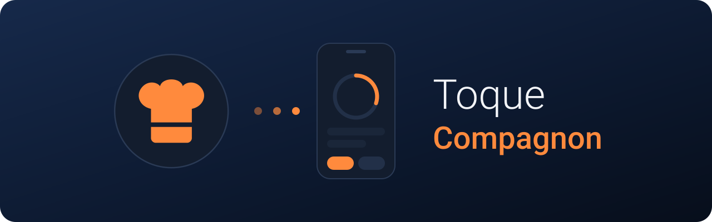

<p align="center"></p>

# Toque Compagnon

🇬🇧 **[English version](README.md)**

L'appli **téléphone et tablette** de [Toque](https://github.com/Wuki60/MrCuisineVibeConnect), l'interface
moderne des robots **Monsieur Cuisine** de Lidl. Elle se relie à votre robot par le **Wi-Fi de la maison** :
vous suivez la cuisson depuis le canapé, vous préparez vos recettes et votre **liste de courses** sur le
téléphone, et vous les retrouvez sur le robot.

## Installer

Téléchargez **`ToqueCompagnon-x.y.z.apk`** directement dans les
**[Releases](https://github.com/Wuki60/ToqueCompagnon/releases/latest)**, depuis le téléphone ou la
tablette, puis ouvrez-le. Android demande d'autoriser l'installation depuis le navigateur : acceptez.
Pas de Play Store, pas de compte. Pour mettre à jour, même chose avec la nouvelle version : elle
s'installe par-dessus l'ancienne, sans rien perdre.

## Ce que fait l'appli

### Suivre la cuisson
- Le programme en cours, le temps restant, la température et l'étape de la recette guidée, en direct.
- Une **notification** quand le robot a besoin de vous : pesée, étape à la main, fin d'une étape ou de
  la cuisson, pause, couvercle ouvert, température atteinte. Elles arrivent **même appli fermée**
  pendant une cuisson, puis l'appli s'arrête toute seule.

### Piloter, dans des limites
- Pause, arrêt, reprise, tare de la balance.
- Ajuster la durée, la température, la vitesse et le sens pendant la cuisson.
- Arrêter une recette guidée (avec confirmation).
- Lancer une cuisson manuelle seulement si le couvercle est fermé et le bol en place. Le robot peut
  l'interdire dans ses réglages.

### Les recettes
- Parcourir et chercher les recettes du robot, avec leurs photos.
- Choisir le nombre de personnes : les quantités s'adaptent.
- Gérer ses favoris.
- **Envoyer une recette au robot** : elle vous attend sur son écran d'accueil, prête à lancer.

### La liste de courses
- Sur une recette, **« Ajouter à la liste »** met tous ses ingrédients dans la liste, aux quantités du
  nombre de personnes choisi.
- Les mêmes ingrédients de plusieurs recettes sont additionnés (200 g + 300 g de farine = 500 g).
- On coche au fil du magasin, on ajoute ses propres articles, et on partage la liste par SMS ou par
  message en un appui.

### Sur téléphone et sur tablette
- Sur téléphone : trois onglets en bas, **Robot**, **Recettes**, **Courses**.
- Sur tablette ou à l'horizontale : un menu sur le côté et deux colonnes (la liste à gauche, la recette
  à droite).
- Le même look que Toque : bleu nuit ou thème clair, les mêmes couleurs d'accent, les mêmes icônes.

## Sécurité

Le téléphone ne remplace pas le robot, il le complète.

- **Restent sur le robot** : lancer une recette, une étape ou un programme, le Turbo, la reprise après
  ouverture du couvercle et la confirmation avant de mixer un contenu chaud.
- Les règles de sécurité du moteur de Toque **ne changent pas** : une commande du téléphone passe par
  les mêmes contrôles qu'un appui sur l'écran du robot, avec des limites en plus.
- Si le téléphone perd la liaison, rien ne change sur le robot : une cuisson continue normalement.

## Vie privée

- **Réseau local uniquement** : pas de compte, pas de serveur, rien ne passe par Internet.
- On relie un téléphone avec un **code affiché sur le robot**. Chaque téléphone reçoit sa propre clé,
  que le robot ne garde que sous forme chiffrée et peut révoquer à tout moment.
- Le robot n'écoute le réseau que si au moins un téléphone est relié ou si l'écran de liaison est ouvert.

## Ce qu'il faut

- Un téléphone ou une tablette **Android 8** ou plus récent.
- Un robot Monsieur Cuisine **Connect** avec [Toque](https://github.com/Wuki60/MrCuisineVibeConnect) à jour.
- Le téléphone et le robot sur le **même réseau Wi-Fi**.

## Langues

L'appli se traduit **avec le même système que Toque** : les textes sont écrits en français dans le code
(`tr("…")`), et chaque langue a son fichier `app/src/main/assets/lang/<code>.json` :

```json
{ "_name": "English", "Liste de courses": "Shopping list" }
```

- `en.json` doit être complet ; les autres langues peuvent avoir des manques (le texte reste alors en
  français), mais aucun texte inconnu et les mêmes `%s` / `%d`. Un test le vérifie.
- Langues disponibles : français, anglais, allemand, espagnol, catalan et ukrainien, comme Toque.

## Contribuer

- Un bug ou une idée pour l'appli du téléphone : [ouvrez une issue ici](https://github.com/Wuki60/ToqueCompagnon/issues/new).
- Un problème sur le robot lui-même : sur le [dépôt de Toque](https://github.com/Wuki60/MrCuisineVibeConnect/issues).
- Le code doit rester **léger** (aucune dépendance sans bonne raison, le moins de réseau et de batterie
  possible) et **ne jamais contourner une règle de sécurité** du robot. Chaque contribution est relue.

## Crédits

- Idée et proposition : @badrbelhaj1 ([#92](https://github.com/Wuki60/MrCuisineVibeConnect/issues/92)).
- Toque et tous ses [contributeurs](https://github.com/Wuki60/MrCuisineVibeConnect#crédits).

🌐 [toqueapp.org](https://toqueapp.org), le site communautaire de Toque · ☕ [Soutenir le projet](https://buymeacoffee.com/toqueapp)

Licence [MIT](LICENSE). Projet indépendant, non affilié à Lidl, SilverCrest ni Hoyer. Ce dépôt ne
contient aucune recette, image ni code de Lidl.
