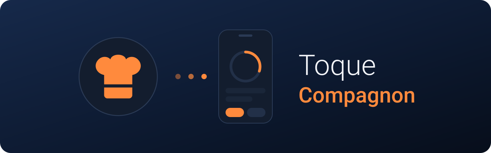

<p align="center"></p>

# Toque Compagnon

🇫🇷 **[Version française](README.fr.md)**

The **phone and tablet** app for [Toque](https://github.com/Wuki60/MrCuisineVibeConnect), the modern
interface for Lidl's **Monsieur Cuisine** cooking robots. It links to your robot over your **home Wi-Fi**:
follow the cooking from the sofa, plan your recipes and your **shopping list** on your phone, and find
them on the robot.

## Install

Download **`ToqueCompagnon-x.y.z.apk`** straight from the
**[Releases](https://github.com/Wuki60/ToqueCompagnon/releases/latest)** on your phone or tablet, then
open it. Android asks you to allow installs from the browser: accept. No Play Store, no account.

After that, the app keeps itself up to date: when it opens, it checks GitHub for a new version and
offers it to you (Android asks you to confirm). You can also check by hand in the **Robot › Updates**
tab, or turn off the check at start-up. The new version installs over the old one without losing
anything.

## What the app does

### Follow the cooking
- The running program, time left, temperature and the guided recipe's current step, live.
- A **notification** when the robot needs you: weighing, a step done by hand, end of a step or of the
  cooking, pause, lid open, temperature reached. They arrive **even with the app closed** during a
  cook, then the app stops by itself.
- A guided recipe left unfinished is shown at rest: resume it from the robot's home screen.

### Control, within limits
- Pause, stop, resume, tare the scale.
- Adjust time, temperature, speed and direction while cooking.
- Stop a guided recipe (with confirmation).
- Start manual cooking only with the lid closed and the bowl in place. The robot can forbid it in its
  settings.

### Recipes
- Browse and search the robot's recipes, with their photos.
- Choose the number of servings: quantities follow.
- Manage your favourites.
- **Send a recipe to the robot**: it waits for you on its home screen, ready to start.
- **Mealie** recipes (self-hosted, linked on the robot): a badge, a "From Mealie" filter, and **your own
  robot setting** for a step, kept on the robot next to the recipe (nothing is copied), to check once on
  the robot before it starts.
- The robot's programs, Yoghurt included on the Connect.

### Shopping list
- On a recipe, **"Add to list"** puts all its ingredients in the list, for the number of servings
  chosen.
- The same ingredient from several recipes is added up (200 g + 300 g of flour = 500 g).
- Tick items off in the shop, add your own, and share the list by text or message in one tap.
- The list stays on the phone and works without the robot.

### On phones and tablets
- On a phone: five tabs at the bottom, **Live**, **Recipes**, **Shopping**, **Log**, **Robot**.
- On a tablet or in landscape: a side menu and two columns (the list on the left, the recipe on the
  right).
- The same look as Toque: midnight blue or light theme, the same accent colours, the same icons.

### Robot tab
- **Rename this phone**: the name the robot shows in its list and its log.
- A phone the robot set to **read-only** says so: it follows everything but controls nothing.

## Safety

The phone does not replace the robot, it complements it.

- **Stay on the robot**: starting a recipe, a step or a program, Turbo, resuming after the lid was
  opened, and confirming before blending hot contents.
- Toque's motor safety rules **do not change**: a command from the phone goes through the same checks
  as a tap on the robot's screen, with extra limits.
- If the phone loses the link, nothing changes on the robot: a cook carries on normally.

## Privacy

- **Local network only**: no account, no server. Only the update check goes through the Internet, to
  GitHub (and it can be turned off in the Robot tab).
- A phone is linked with a **code shown on the robot**. Each phone gets its own key, which the robot
  only keeps in hashed form and can revoke at any time.
- The robot only listens on the network when at least one phone is linked or the pairing screen is open.

## Requirements

- An **Android 8** or newer phone or tablet.
- A Monsieur Cuisine **Connect** or **Smart** (in testing) robot running [Toque](https://github.com/Wuki60/MrCuisineVibeConnect) 0.10.0 or newer
  (Toque 0.13.0 for everything above: renaming the phone, Mealie, read-only phones).
  On the Smart, the app also shows its programs (Mixer, Sous-vide, Slow cook…).
- The phone and the robot on the **same Wi-Fi network**. The app finds the robot by itself, even when
  its address changes (the robot announces itself on the Wi-Fi, and the phone also searches its network).

## Languages

The app is translated **with the same system as Toque**: texts are written in French in the code
(`tr("…")`), and each language has its file `app/src/main/assets/lang/<code>.json`:

```json
{ "_name": "English", "Liste de courses": "Shopping list" }
```

- `en.json` must be complete; other languages may have gaps (the text then stays in French), but no
  unknown text and the same `%s` / `%d`. A test checks it.
- Available in French, English, German, Spanish, Catalan, Ukrainian and Polish, like Toque. By default the app
  follows the phone's language; change it in **Robot › Langue · Language**.

## Building

- You need JDK 17 and the Android SDK with platform 34.
- Debug APK: `./gradlew :app:assembleDebug`. Tests: `./gradlew :app:testDebugUnitTest`.
- No robot at hand? `./gradlew :core:companionDemo -PdemoArgs="--lan"` starts a demo robot on the PC: a
  simulated motor base and 12 invented recipes. Type `help` in its console to play the robot (`pair` shows the pairing code).
- `core/` is a copy of Toque's `core/` folder and is edited in the Toque repository (see [core/README.md](core/README.md)).

## Contributing

- A bug or an idea for the phone app: [open an issue here](https://github.com/Wuki60/ToqueCompagnon/issues/new).
- A problem with the robot itself: on the [Toque repository](https://github.com/Wuki60/MrCuisineVibeConnect/issues).
- The code must stay **light** (no dependency without a good reason, as little network and battery as
  possible) and **never get around a robot safety rule**. Every contribution is reviewed.

## Credits

- Idea and proposal: @badrbelhaj1 ([#92](https://github.com/Wuki60/MrCuisineVibeConnect/issues/92)).
- Toque and all its [contributors](https://github.com/Wuki60/MrCuisineVibeConnect#credits).

🌐 [toqueapp.org](https://toqueapp.org), Toque's community site · ☕ [Support the project](https://buymeacoffee.com/toqueapp)

[MIT](LICENSE) licence. Independent project, not affiliated with Lidl, SilverCrest or Hoyer. This
repository contains no Lidl recipes, images or code.
